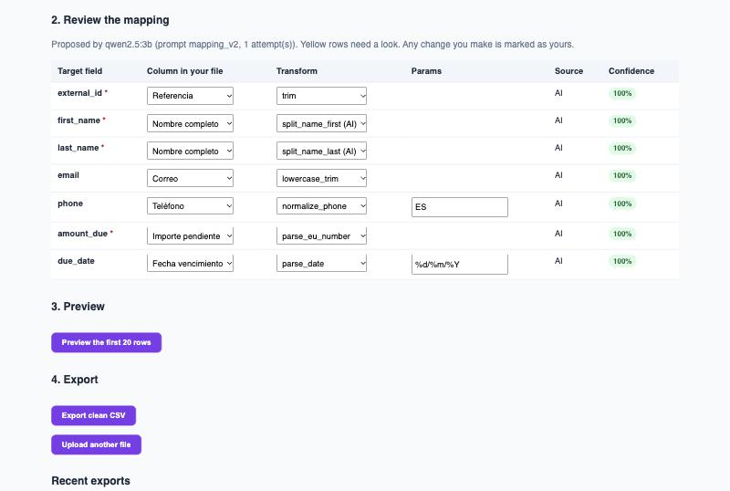
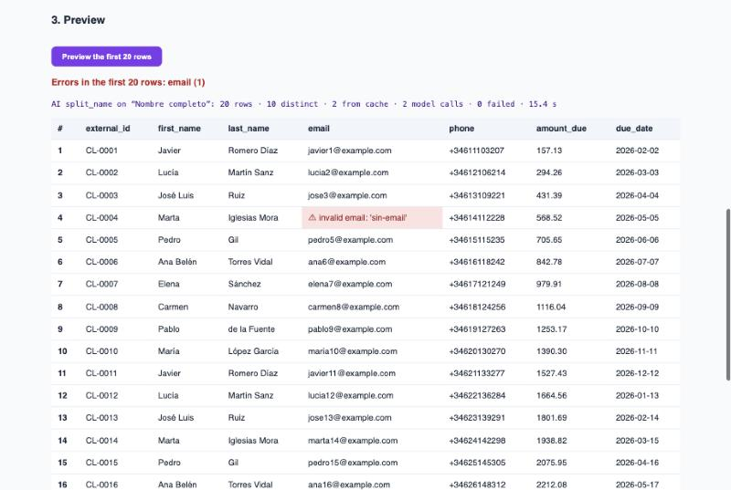
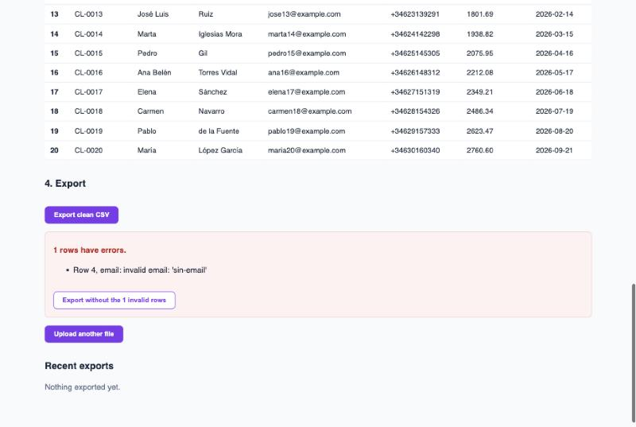
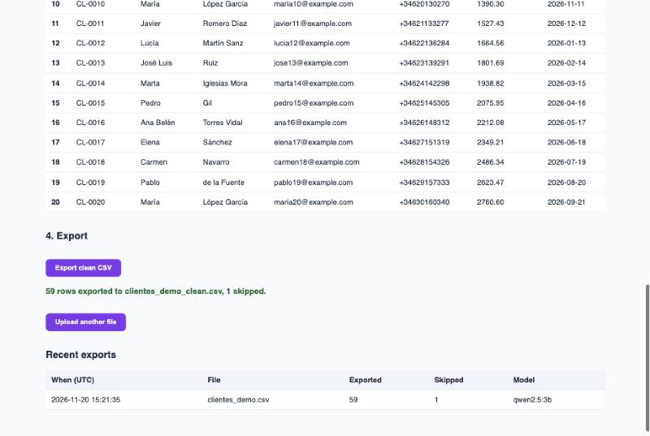
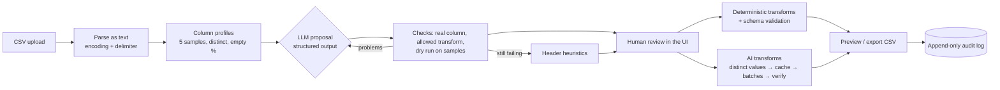

# smart-csv-mapper

Every client sends their data in their own format: different column names, orders, number and date
formats, sometimes a full name where you need first and last name. Mapping each new file by hand takes
engineering time. **smart-csv-mapper** lets a non-technical user do it in minutes:

1. **An LLM proposes** how the file's columns map to a fixed target schema, and which transform each one needs.
2. **A person reviews** the proposal; low-confidence rows are highlighted.
3. **Deterministic code** transforms and validates every cell. AI is only used where code can't do the job
   (splitting full names), on **distinct values only**, **cached**, and **verified**.

Runs **free and local** with [Ollama](https://ollama.com) (`qwen2.5:3b`): the data never leaves the machine.
All data in this repository is fake.

> A simplified, open re-implementation of a production system I built for client onboarding,
> written from scratch as a practice and portfolio project.

| Review the proposal | Preview with per-cell errors |
|---|---|
|  |  |
| **Invalid rows are explained before export** | **Export and audit history** |
|  |  |

## How it works



- **Only a profile reaches the model**, never the whole file: column names, 5 distinct samples, counts.
- The model answers in **JSON constrained by a schema** (Ollama structured outputs, `temperature: 0`), choosing
  only from a **closed catalog of named transforms**.
- Its answer is **checked against the data**: the column must exist, the transform must fit the field type, and
  it is **dry-run on the column's samples**. Problems go back to the model once; then header heuristics take over.
  Self-reported confidence is not trusted: it is capped unless the heuristics agree.
- **AI transforms run per column**: 1,000 rows with 10 distinct names → 1 model call, and 0 on the next file.
  A split is accepted only if first + last name rebuild the input **letter by letter**.

## Results

**Evals** (`make eval`): 15 hand-labelled CSVs (Spanish, English, UK, German, Portuguese and French headers,
abbreviations, distractor columns, `Surname, First`, currency symbols…) and 60 hard names. CI runs them on Ollama
whenever a prompt, a transform or the eval set changes, and fails below 90 %.

| qwen2.5:3b, same model | prompt v1 | prompt v2 + checks |
|---|---|---|
| Mapping: column **and** transform right | 64.8 % | **97.1 %** |
| Mapping: column right | 94.3 % | 97.1 % |
| Name split, exact | 93.3 % | **96.7 %** |
| Time per proposal (M2, 8 GB) | 13.3 s | 22.6 s |

v1 lowercased ids (13/15 files), split columns that were already split, read US numbers as European, and its
heuristic took "Amount **Due**" for the due date. The fix was mostly not prompt wording but **deterministic
checks on the model's answer** (above), plus a v2 prompt. The name check became case-sensitive: `maría lópez`
now fails loudly instead of silently becoming `López`. Full reports:
[v1](evals/results/2026-11-20-qwen2.5-3b-mapping_v1.md) · [v2](evals/results/2026-11-20-qwen2.5-3b-mapping_v2.md).

**Live run** (300 fake rows): 33 distinct names → 3 model calls (5 already cached by the preview);
299 rows exported, 1 skipped with its reason (invalid email).

## Run it

Requirements: macOS or Linux, [uv](https://docs.astral.sh/uv/), Node ≥ 22 with npm ≥ 11, Ollama.

```bash
make ollama-setup          # once: start Ollama and pull qwen2.5:3b (~2 GB)
make install               # backend (uv) and frontend (npm) dependencies
make dev                   # UI on http://localhost:5173 · API docs on http://localhost:8000/docs
```

Upload [`examples/clientes_demo.csv`](examples/clientes_demo.csv), review, preview, export.

<details>
<summary>Or drive the API with curl</summary>

```bash
FID=$(curl -s -F file=@examples/clientes_demo.csv localhost:8000/files | jq -r .file_id)
curl -s -X POST localhost:8000/files/$FID/suggest > proposal.json      # the model's proposal
jq '{fields, rows: 5}' proposal.json | curl -s -X POST -H 'content-type: application/json' \
  -d @- localhost:8000/files/$FID/preview                               # first rows + errors
jq '{fields, skip_invalid: true}' proposal.json | curl -s -X POST -H 'content-type: application/json' \
  -d @- localhost:8000/files/$FID/export -o clean.csv                   # full file
curl -s localhost:8000/audit                                            # who exported what
```
</details>

Other commands: `make test` (both suites), `make eval` (evals against the local model), `make help`.

## Stack and layout

| | |
|---|---|
| Backend | Python 3.12, FastAPI, Pydantic v2, httpx, SQLite (audit), Redis (optional cache) |
| Frontend | React 19, TypeScript, Vite, TanStack Query, Zod |
| Model | Ollama `qwen2.5:3b` behind an `LLMProvider` interface |
| Quality | pytest, Vitest + Testing Library + MSW, ruff, mypy `--strict`, ESLint, Prettier, gitleaks |

```
backend/src/smart_csv_mapper/
  ingest/          parse uploads, column profiles, in-memory store
  transforms/      closed catalog of pure transforms (Ok / Err)
  mapping/         prompt, answer checks, heuristics, suggestion
  ai_transforms/   name splitting: distinct values, cache, batches, verification
  llm/             LLMProvider: Ollama, fake
  pipeline.py      apply a reviewed mapping: transform, validate, duplicates
  export.py        CSV with formula-injection protection
  audit.py         append-only audit log
  evaluation.py    eval scoring and report
frontend/src/      upload, review table, preview, export, history
evals/             datasets, names, runner, reports
docs/              design decisions (ADRs) and delivery plan
```

## Quality

- **100 % branch coverage** enforced on both sides (250 backend tests, 56 frontend tests).
- **Tests never call a model or the network**: a scripted `FakeProvider`, `httpx.MockTransport` and MSW at the
  boundary. Only the evals use a real model.
- **Mutation spot-checks on every PR**: conditions that matter are deliberately broken to prove a test fails;
  surviving mutations led to new tests.
- **CI on every PR**: lint, types, a no-ternary rule, tests, build, generated API types in sync with the backend,
  secret scanning, and the evals job.

## Design decisions

The full reasoning is in [docs/PLAN.md](docs/PLAN.md) (one ADR per decision). The short version:

**Data in**
- Everything is read as **text, no pandas**: nothing is guessed silently; types come from explicit transforms.
- UTF-8 (with BOM) first, then charset-normalizer; `csv.Sniffer` with a counting fallback.
- **Stable error codes** (`duplicate_header`, `too_many_rows`, `malformed_csv`…) so the UI can explain each problem.

**The model**
- One `LLMProvider` interface; Ollama by default (free, local), a fake for tests.
- Retries only where they help: network errors, timeouts and 5xx with exponential backoff; 4xx fails fast.
- Versioned prompts (`mapping_v2`, `split_name_v2`); sample values are marked as data, not instructions.
- `constant` and `map_values` are **for people only**: in a live run the model picked `constant` for the id
  column, which would have given every row the same id.

**AI where code can't**
- Column-level, not cell-level: distinct values → cache → batches of 20 → verify → apply to every row.
- Cache key = transform + prompt version + model + value: changing any of them never serves stale results.

**Output**
- Preview processes the first 20 rows (fast, even with AI); export processes everything and reuses the cache.
- Export refuses invalid rows unless asked, and says which cell failed and why; duplicate ids are errors.
- **CSV injection protection**: `=`, `@`, tab and CR always neutralised; `+`/`-` only when the cell is not a
  plain number or an E.164 phone, so `+34612345678` survives.
- **Append-only audit log** (SQLite triggers reject UPDATE and DELETE): file SHA-256, never its content.

**Frontend**
- API types generated from the backend's OpenAPI, and every response validated at runtime with Zod schemas
  that `satisfies` those types; CI fails if the generated types drift.
- The UI never applies a proposal silently: yellow rows below 0.7, edits marked "set by you", AI transforms labelled.

**Operations**
- `/readyz` checks the model; `/healthz` never does (a stopped model should take the API out of rotation, not restart it).
- JSON logs with a request id; every model call logs model, latency and tokens.

## What I'd change for production

- **Identity and access**: corporate SSO (OIDC) instead of the demo user, roles per data domain, and the audit
  log in a store the app can only append to (e.g. a database role with INSERT only, or WORM storage).
- **Storage and scale**: PostgreSQL instead of in-memory uploads and SQLite; large files processed as
  background jobs from a queue (or Kafka), with **idempotent** imports so a re-run never duplicates rows.
- **The model**: hosted inside the company's cloud account (for example Bedrock), personal data masked before
  it reaches the model, per-team quotas and cost tracking, and a fallback model.
- **Cache**: Redis shared across instances; if it is down, treat it as a cache miss instead of failing.
- **Evals**: a larger, real-world-shaped eval set; online feedback from corrections in the review table
  (each "set by you" is a labelled example); evals gating every prompt or model change.
- **Observability**: OpenTelemetry traces across API, pipeline and model calls; SLOs on proposal latency and
  export success; alerts on fallback rate.
- **Deployment**: non-root container images, Helm chart and GitOps (Argo CD) on Kubernetes or OpenShift,
  infrastructure as code with Terraform.
- **Transforms**: an expression language such as JSONata for client-specific rules, still validated by dry runs.
- **Testing**: browser end-to-end tests (Playwright) for the main flow.

## License

MIT
